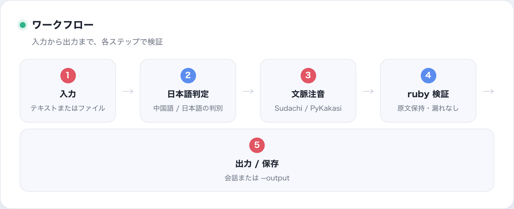

# Bunomi

**[English](README.md) | [简体中文](README.zh-CN.md) | [日本語](README.ja.md)**

Agent 向けの**日本語ふりがなスキル**です：入力が日本語らしいかを判定し、
漢字に検証済みの `<ruby>` 平仮名・ローマ字ふりがなを付け、書き出す前に結果を
検証します。リポジトリ自体がスキル（ルート `SKILL.md`）で、CLI はその背後に
ある決定的なエンジンです。

## これは何か

- **スキル層**：ルート `SKILL.md` / `PROMPT.md` を Codex・Claude など各 Agent が
  利用；`package.json` はスキルのメタデータ。
- **エンジン層**：ローカル CLI（`bunomi`）+ Python パッケージ。共有コアの
  Sudachi 読み、ruby 描画、安全な書き出し。PyKakasi は GPL-3.0 の依存を含む
  任意の比較エンジンとして分離しています。
- **境界**：歌詞の取得・翻訳・レイアウトは専用の歌詞スキルと共有翻訳スキル
  `$japanese-translation` に任せ、Bunomi は注音だけを行います。

<p align="center">
  
  <br><sub>平仮名ふりがな：文脈読み（降り止む → ふりやむ）、送り仮名は ruby の外</sub>
</p>

## Agent での使い方

Codex の既定スキルディレクトリへインストール（既存なら `--force`）：

```bash
.venv/bin/python scripts/install_bunomi_skill.py
```

Agent は `$bunomi` を参照して `SKILL.md` のワークフローに従います。スキル
フレームワークがない環境では `PROMPT.md` をそのままプロンプトとして使えます。

<p align="center">
  
  <br><sub>ワークフロー：入力 → 判定 → 注音 → 検証 → 出力/保存</sub>
</p>

## 開発者向け（CLI）

通常の日本語テキストに決定的な振り仮名を付ける CLI です。

    echo "日本語を読む" | .venv/bin/bunomi
    .venv/bin/bunomi "日本語を読む" --romaji
    .venv/bin/bunomi "日本語を読む" --format html
    .venv/bin/bunomi --file lesson.txt

テキストと標準入力は Ruby 内容を標準出力へ出します。ファイル入力は元ファイルを
上書きせず、同じフォルダーに時刻付きファイルを作り、既定で HTML を出力します。
形式は markdown または html を指定できます。

言語判定は保守的な文字種ヒューリスティックです。仮名のない入力、または漢字数の
4 分の 1 未満しか仮名がない入力は曖昧として拒否します。中日で共有される漢字の言語を
識別したり、混在する文章を自動分割したりはできません。漢字だけの文をユーザーが
日本語だと明示した場合のみ `--assume-japanese` を使い、CLI の警告も伝えてください。
翻訳、歌詞検索、歌詞専用レイアウトは別の Skill が担当します。

## 翻訳

Bunomi は一般的な日本語テキストの注音だけを担当します。翻訳は共有の
[japanese-language-core](https://github.com/qweihu/japanese-language-core) にある
$japanese-translation Skill に委譲し、Bunomi の出力には含めません。

## 開発インストール

```bash
python3 -m venv .venv
.venv/bin/python -m pip install -e .
```

公開の [japanese-language-core](https://github.com/qweihu/japanese-language-core)
`v0.4.0` の `[reading]` 拡張は Bunomi の依存関係から自動でインストールされます。
両リポジトリをローカル開発する場合：

```bash
git clone https://github.com/qweihu/japanese-language-core.git ../japanese-language-core
.venv/bin/python -m pip install -e "../japanese-language-core[reading]"
.venv/bin/python -m pip install -e . --no-deps
```

## テスト

```bash
PYTHONPATH=src python3 -m unittest discover -s tests -v
.venv/bin/python scripts/production_audit.py
```

プロダクション監査はスキル構造・ゴールデン読み・CLI 形式・日本語判定・書き出し
安全を確認します。最新結果は [docs/production-audit.md](docs/production-audit.md)。

## プロジェクト構成

    SKILL.md       Agent 向け注音手順
    PROMPT.md      Skill 非対応環境向け Prompt
    src/bunomi/    日本語判定、共有読音 API、Ruby 描画、検証、CLI
    scripts/       Skill インストーラー
    tests/         単体テストと本番監査

## 共有言語コア

Bunomi は [japanese-language-core](https://github.com/qweihu/japanese-language-core)
の読音 API を再利用します。共有コアは日本語の読みと言語共通契約を担当し、
Bunomi は一般文の判定、Ruby 表示と Agent の流れを担当します。

MIT License
