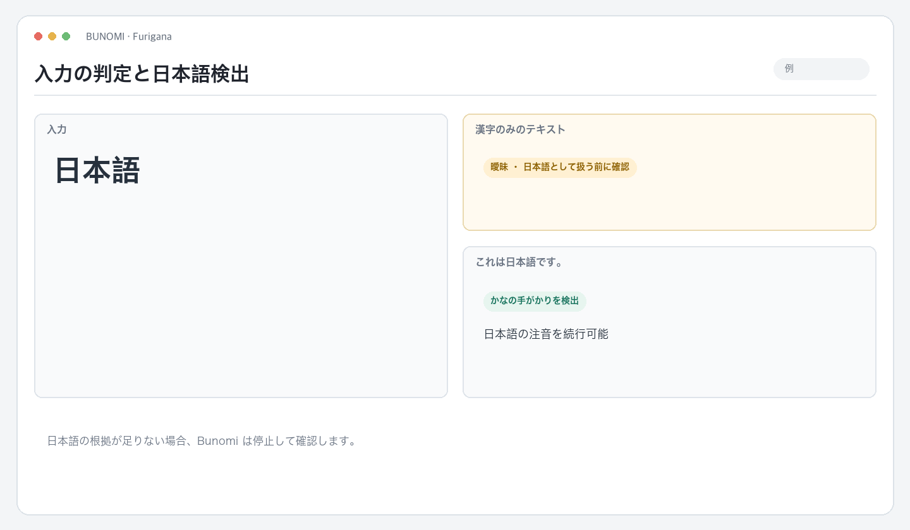
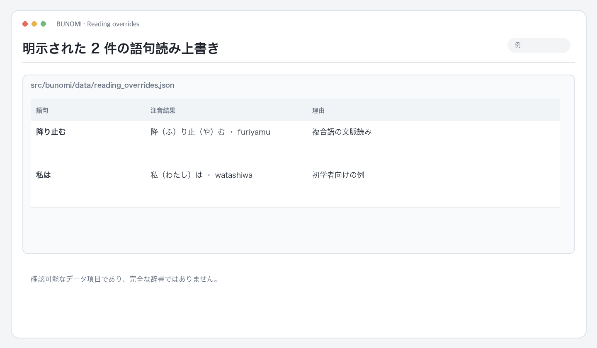
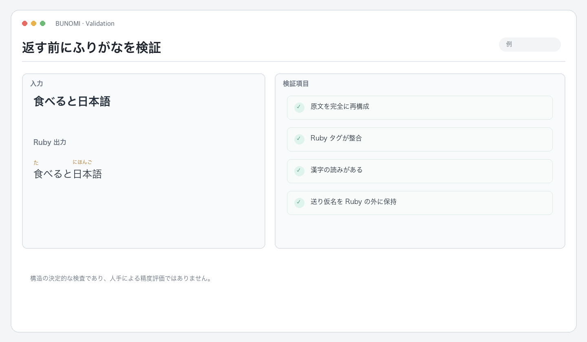

# Bunomi

**[English](README.md) · [简体中文](README.zh-CN.md) · [日本語](README.ja.md)**

記事、メモ、メッセージ、教材など、一般的な日本語テキスト向けのふりがな Skill です。文脈に沿って読みを付け、注音結果を検証し、既定で単体で開ける HTML を返します。

 注音例 · 「降り止む」の漢字に読みを付け、り・むは Ruby の外に保ちます。

## 処理の流れ

~~~text
ユーザー提供テキスト → 文字種の保守的な判定 → 文脈注音 → Ruby と原文を検証 → HTML
~~~

Agent の手順はリポジトリ直下の <code>SKILL.md</code> にあります。Skill を導入すれば Agent に注音を依頼できます。ローカルの <code>bunomi</code> CLI は決定的な処理エンジンで、スクリプトやファイル処理にも使えます。

## 判定ルールと限界

Bunomi は日本語の文字種シグナルを使います。完全な言語識別モデルではありません。

- ひらがな・カタカナを含まないテキストは曖昧とみなし、既定で処理を拒否します。
- 漢字が 4 文字以上ある場合、漢字 4 文字につき仮名 1 文字未満でも曖昧と判定します。
- 漢字だけの部分が中国語か日本語かは識別できず、中日混在文から日本語部分だけを自動抽出することもできません。
- 漢字だけの文章が日本語だとユーザーが確認した場合は、CLI の <code>--assume-japanese</code> を使えます。警告は結果に残ります。

言語が不明瞭な場合は、推測させず日本語の部分を明示してください。

 判定例 · 「日本語」は曖昧ですが、「これは日本語です。」にはかながあります。

## 読み、原文保持、検証

Bunomi は [japanese-language-core](https://github.com/qweihu/japanese-language-core) の読音 API を利用します。通常の利用では、エンジンや辞書を選ぶ必要はありません。

- 既定はひらがなの振り仮名です。ヘボン式ローマ字は依頼時のみ使います。
- 原文、改行、句読点、日本語以外の部分、意味のある空行を保持します。
- 送り仮名は Ruby の外に残します。「降り止む」では漢字部分に読みを付け、り・むは原文のままです。
- 出力前に Ruby 構造、原文の完全再構成、漢字の読みを検証します。失敗時はエラーを返し、黙って途中まで出力しません。
- 語句上書きは少数で確認可能です：降り止む → ふりやむ、私は → わたしは。辞書や網羅的な例外一覧ではありません。

 上書きデータ · 語句、読み、設定理由を一件ずつ確認できます。

 検証例 · 原文復元、Ruby、読みの網羅、送り仮名の位置を確認。

## 出力モード

Agent Skill の既定出力は単体 HTML です。スタイルをページ内に含み、システムフォントを使うため、CDN は不要です。Markdown やローマ字は依頼に応じて切り替えられます。

CLI は入力方法に応じて既定の出力が変わります。

| 入力 | 既定の結果 |
| --- | --- |
| テキスト引数または標準入力 | Ruby 内容を端末へ出力 |
| UTF-8 テキストファイル | 元ファイルと同じフォルダーに時刻付き HTML を新規作成 |

元ファイルは上書きしません。ファイル入力では <code>--format markdown</code> または <code>--format html</code> を指定できます。

 HTML 出力 · 生成したページで漢字の上に読みを表示します。

~~~bash
# Ruby マークアップを出力
echo "日本語を読む" | .venv/bin/bunomi

# ヘボン式を指定
.venv/bin/bunomi "日本語を読む" --romaji

# 同じフォルダーに時刻付き HTML を作成
.venv/bin/bunomi --file lesson.txt

# Markdown を明示
.venv/bin/bunomi --file lesson.txt --format markdown
~~~

 ローマ字オプション · ユーザーが明示した場合にだけ切り替えます。

## Skill のインストール

Python 3.10 以上：

~~~bash
python3 -m venv .venv
.venv/bin/python -m pip install -e .
.venv/bin/python scripts/install_bunomi_skill.py
~~~

リポジトリを Codex の既定 Skill ディレクトリに導入します。既存のものを置き換える場合は <code>--force</code> を付けます。Agent では <code>$bunomi</code> を使い、Skill 非対応の環境では <code>PROMPT.md</code> を利用できます。

パッケージは共有 Core の読音拡張を導入します。任意の PyKakasi 比較エンジンは別途インストールが必要で、依存チェーンに GPL-3.0 が含まれるため既定依存には含まれません。

## Bunomi の対象外

Bunomi は一般的な日本語テキストの注音だけを担当します。歌詞検索・歌詞ページの整理・翻訳・URL 取得・歌詞専用レイアウトは行いません。すべての読みが正しいとは主張せず、構造検証と少数の上書き規則で挙動を確認できるようにしています。曖昧または検証できない場合は、その状態を伝えます。

## 開発

~~~bash
python3 -m venv .venv
.venv/bin/python -m pip install -e .
PYTHONPATH=src .venv/bin/python -m unittest discover -s tests -v
.venv/bin/python scripts/production_audit.py
~~~

本番監査は Skill 構造、ゴールデン読み、CLI 形式、日本語判定、安全なファイル出力を確認します。

## 構成

~~~text
SKILL.md                         Agent ワークフロー
PROMPT.md                        Skill 非対応環境向け Prompt
src/bunomi/                      判定、Core アダプター、Ruby 描画、検証、CLI
src/bunomi/data/reading_overrides.json
scripts/install_bunomi_skill.py
tests/                            単体テストと本番監査
~~~

MIT License。詳細は [LICENSE](LICENSE) を参照してください。
