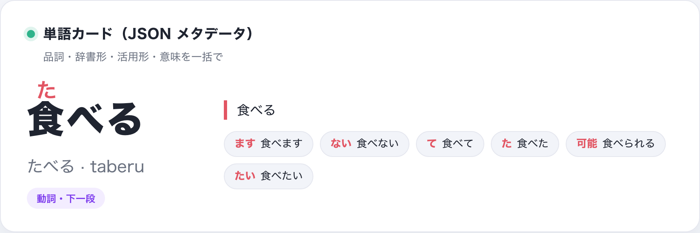
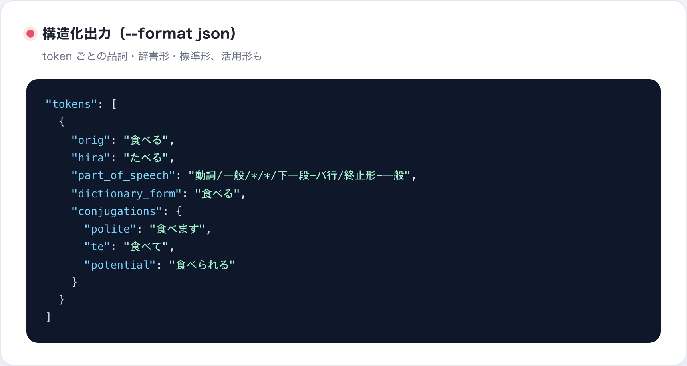
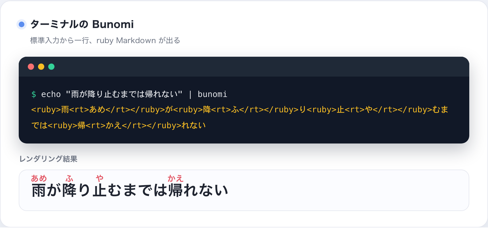
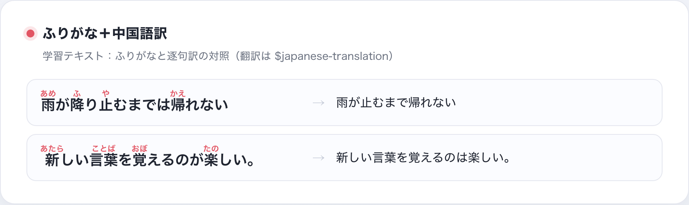
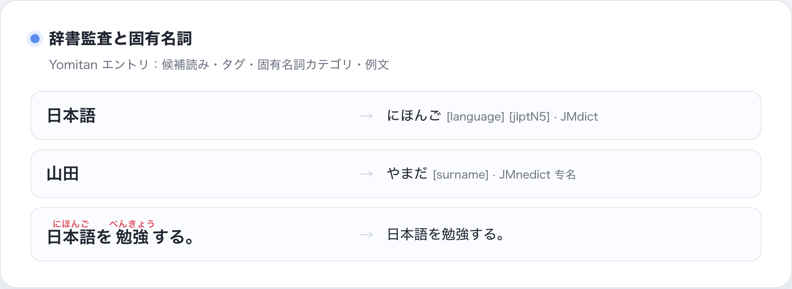
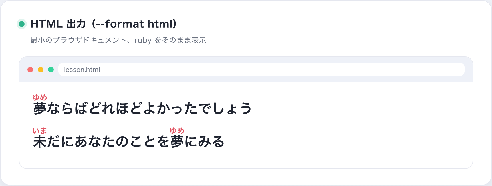

# Bunomi

Agent 向けの**日本語ふりがなスキル**です：入力が日本語らしいかを判定し、
漢字に検証済みの `<ruby>` 平仮名・ローマ字ふりがなを付け、書き出す前に結果を
検証します。リポジトリ自体がスキル（ルート `SKILL.md`）で、CLI はその背後に
ある決定的なエンジンです。

## これは何か

- **スキル層**：ルート `SKILL.md` / `PROMPT.md` を Codex・Claude など各 Agent が
  利用；`package.json` はスキルのメタデータ。
- **エンジン層**：ローカル CLI（`bunomi`）+ Python パッケージ。決定的な読み
  （Sudachi 優先、PyKakasi フォールバック）、ruby 描画、安全な書き出し。
- **境界**：歌詞の取得・翻訳・レイアウトは専用の歌詞スキルと共有翻訳スキル
  `$japanese-translation` に任せ、Bunomi は注音だけを行います。

## プレビュー

GitHub の README は `<ruby>` を描画しないため、実際の注音結果を画像で示します。

<p align="center">
  
  <br><sub>平仮名ふりがな：文脈読み（降り止む → ふりやむ）、送り仮名は ruby の外</sub>
</p>

<p align="center">
  
  <br><sub>ローマ字モード（--romaji）：すべての仮名をヘボン式ローマ字で出力</sub>
</p>

<p align="center">
  
  <br><sub>単語カード：品詞・辞書形・活用形・意味を一括で</sub>
</p>

<p align="center">
  
  <br><sub>JSON 出力：token ごとの品詞・辞書形・標準形・活用形</sub>
</p>

<p align="center">
  
  <br><sub>ターミナルの Bunomi：標準入力から一行、ruby Markdown が出て下に描画結果</sub>
</p>

<p align="center">
  
  <br><sub>学習テキスト：ふりがな付き行と中国語訳の対照</sub>
</p>

<p align="center">
  
  <br><sub>辞書監査：候補読み・タグ・JMnedict 固有名詞・例文</sub>
</p>

<p align="center">
  
  <br><sub>HTML 出力（--format html）：最小のブラウザドキュメント、ruby をそのまま表示</sub>
</p>

<p align="center">
  
  <br><sub>ワークフロー：入力 → 判定 → 注音 → 検証 → 出力/保存</sub>
</p>

**中文版 / English 版**：同じ 9 枚の画像が `screenshot/zh/` と `screenshot/en/` に
あります。生成テンプレートは `scripts/screenshot/showcase.html`。

## Agent での使い方

Codex の既定スキルディレクトリへインストール（既存なら `--force`）：

```bash
.venv/bin/python scripts/install_bunomi_skill.py
```

Agent は `$bunomi` を参照して `SKILL.md` のワークフローに従います。スキル
フレームワークがない環境では `PROMPT.md` をそのままプロンプトとして使えます。

## 開発者向け（CLI）

```bash
echo "夢ならばどれほどよかったでしょう" | .venv/bin/bunomi
.venv/bin/bunomi --file lesson.txt --format html
.venv/bin/bunomi "日本語を読む" --output ./exports/lesson.md --create-parent
.venv/bin/bunomi "雨が降り止むまでは帰れない" --engine sudachi
```

既定は標準出力のみ。書き出しは明示的な `--output` が必要で、上書きには
`--overwrite` が必要です。`--engine auto` は Sudachi 優先、`--engine pykakasi`
は互換フォールバック。審査済みのフレーズ上書きは既定で有効、`--no-overrides`
で診断できます。

JSON 出力には token ごとのメタデータ（品詞・辞書形・標準形）が含まれ、
`--conjugations` で活用形、`--sentences/--sentence-links` で Tatoeba 例文を
付与できます。

## 翻訳

翻訳が求められたら、Bunomi は共有スキル `$japanese-translation`
（[japanese-language-core](https://github.com/qweihu/japanese-language-core)
リポジトリ）に引き渡します：

```bash
git clone https://github.com/qweihu/japanese-language-core.git
python3 scripts/install_skill.py --force
```

## 開発インストール

```bash
python3 -m venv .venv
.venv/bin/python -m pip install -e .
```

公開の [japanese-language-core](https://github.com/qweihu/japanese-language-core)
の `v0.3.0` を参照します（読みには `[reading]` 拡張が必要）。ローカル開発：

```bash
.venv/bin/python -m pip install -e "/Users/qwei/Coding/japanese-language-core[reading]"
.venv/bin/python -m pip install -e . --no-deps
```

## テスト

```bash
PYTHONPATH=src python3 -m unittest discover -s tests -v
.venv/bin/python scripts/production_audit.py
```

プロダクション監査はスキル構造・ゴールデン読み・CLI 形式・日本語判定・書き出し
安全を確認します。最新結果は [docs/production-audit.md](docs/production-audit.md)。

## プロジェクト構成

```text
SKILL.md                     # スキル入口（リポジトリ＝スキル）
PROMPT.md                    # スキルなし環境用プロンプト
package.json                 # スキルメタデータ
agents/openai.yaml           # Codex UI メタデータ
docs/requirements.md         # MVP 要件と受入基準
docs/yomitan-data-plan.md    # Yomitan 辞書の取得・バージョン・監査計画
src/bunomi/core.py           # 判定・エンジン適応・ruby 描画・検証
src/bunomi/engine.py         # japanese_language_core.reading の入口
src/bunomi/cli.py            # CLI と安全な書き出し
scripts/install_bunomi_skill.py # スキルインストーラ
scripts/fetch_yomitan_data.py # Yomitan 辞書スナップショット取得
scripts/audit_yomitan_data.py  # スナップショット検証
scripts/audit_reading_disagreements.py # エンジンと辞書候補の差分
tests/test_core.py           # 外部サービス不要のコアテスト
```

## Yomitan 辞書スナップショット

Yomitan/JMdict データは辞書の証拠・監査入力として使い、既定の文脈読みは
Sudachi が担当します：

```bash
.venv/bin/python scripts/fetch_yomitan_data.py --extract
.venv/bin/python scripts/audit_yomitan_data.py
.venv/bin/python scripts/audit_reading_disagreements.py
```

共有エンジンのソース・テスト・配布メタデータは独立リポジトリにあります。
データは無視対象の `var/yomitan/` に保存し、`manifest.json` でバージョン管理します。
詳細は [docs/yomitan-data-plan.md](docs/yomitan-data-plan.md)。
