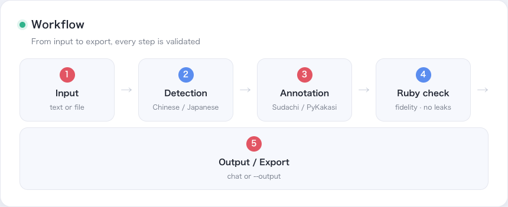
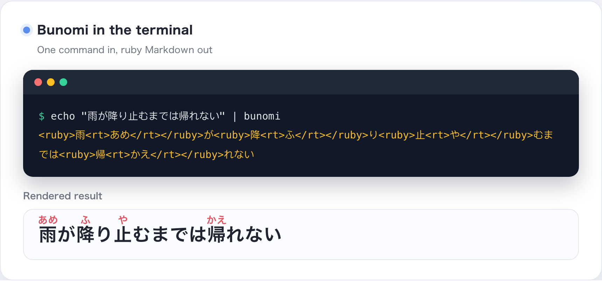
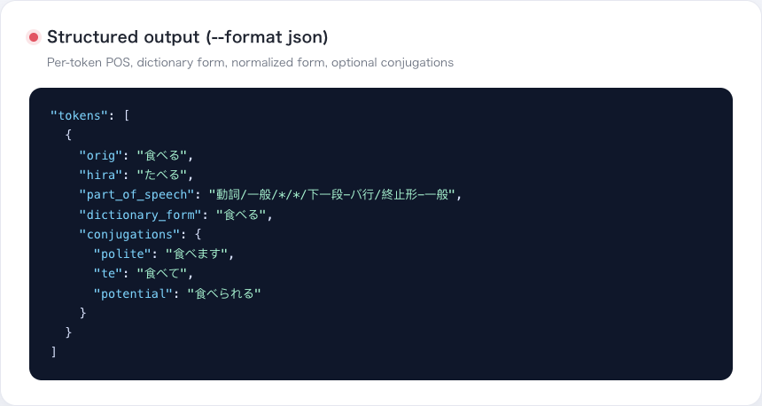
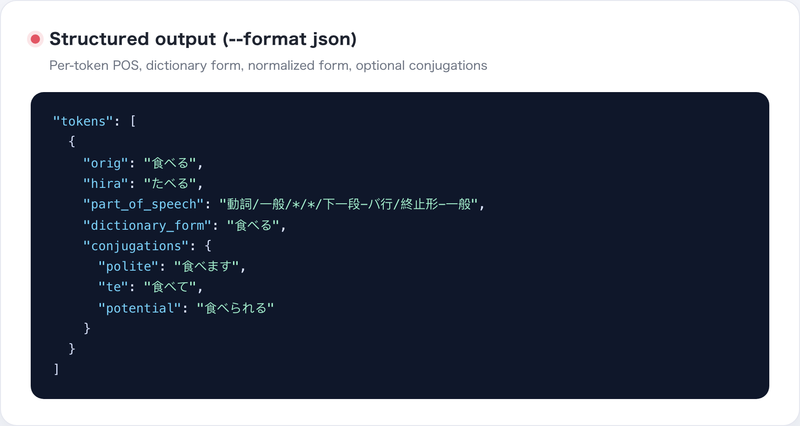
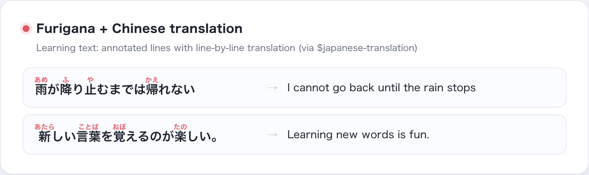
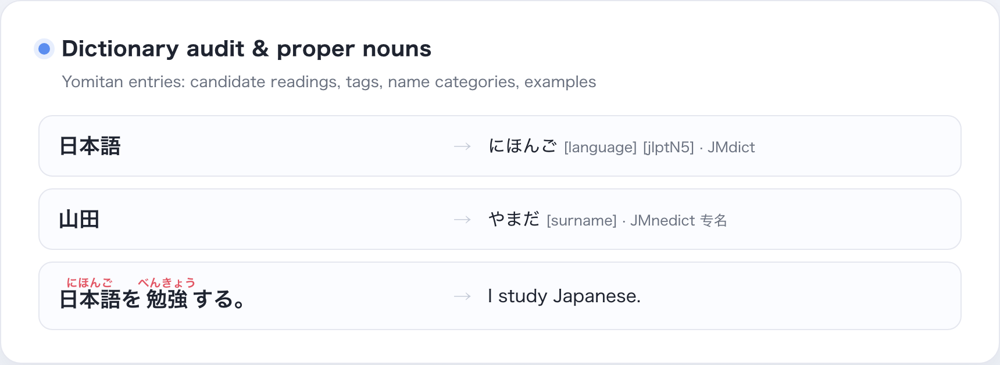

# Bunomi

**[English](README.md) | [简体中文](README.zh-CN.md) | [日本語](README.ja.md)**

An **Agent-facing Japanese furigana skill**: it decides whether input looks
like Japanese, adds validated `<ruby>` hiragana/romaji readings to kanji, and
verifies the result before export. The repository itself is the skill (root
`SKILL.md`); the CLI is the deterministic engine behind it.

## What it is

- **Skill layer**: root `SKILL.md` / `PROMPT.md` for Codex, Claude and other
  agents; `package.json` is the skill metadata.
- **Engine layer**: local CLI (`bunomi`) + Python package for deterministic
  readings (Sudachi first, PyKakasi fallback), ruby rendering and safe export.
- **Boundary**: lyric acquisition, translation and layout belong to dedicated
  lyric skills and the shared `$japanese-translation` skill; Bunomi only
  annotates.

<p align="center">
  
  <br><sub>Hiragana furigana: contextual readings (降り止む → ふりやむ) with okurigana outside ruby</sub>
</p>

## For agents

Install into the Codex default skill directory (add `--force` when the skill
already exists):

```bash
.venv/bin/python scripts/install_bunomi_skill.py
```

Agents reference `$bunomi` and follow the `SKILL.md` workflow; environments
without a skill framework can use `PROMPT.md` directly.

<p align="center">
  
  <br><sub>Workflow: input → detection → annotation → validation → output/export</sub>
</p>

## For developers (CLI)

```bash
echo "夢ならばどれほどよかったでしょう" | .venv/bin/bunomi
.venv/bin/bunomi --file lesson.txt --format html
.venv/bin/bunomi "日本語を読む" --output ./exports/lesson.md --create-parent
.venv/bin/bunomi "雨が降り止むまでは帰れない" --engine sudachi
```

Output goes to stdout by default. Export requires an explicit `--output`;
overwriting requires `--overwrite`. `--engine auto` prefers Sudachi, and
`--engine pykakasi` is the compatibility fallback. Reviewed phrase overrides
are enabled by default; use `--no-overrides` for diagnostics.

<p align="center">
  
  <br><sub>Bunomi in the terminal: one command in, ruby Markdown out, with rendered result below</sub>
</p>

<p align="center">
  
  <br><sub>Romaji mode (--romaji): every kana rendered in Hepburn romaji</sub>
</p>

JSON output carries per-token metadata (POS, dictionary form, normalized
form) plus optional `--conjugations` and Tatoeba example sentences via
`--sentences/--sentence-links`.

### Output formats

<p align="center">
  
  <br><sub>Word card: POS, dictionary form, conjugations and gloss at a glance</sub>
</p>

<p align="center">
  
  <br><sub>JSON output: per-token POS, dictionary form, normalized form and conjugations</sub>
</p>

<p align="center">
  
  <br><sub>HTML output (--format html): a minimal browser document, ruby rendered as-is</sub>
</p>

**日本語版 / 中文版**: the same images live in `screenshot/ja/` and
`screenshot/zh/`; the generator template is `scripts/screenshot/showcase.html`.

## Translation

When the user asks for a translation, Bunomi hands the text to the shared
`$japanese-translation` skill from the
[japanese-language-core](https://github.com/qweihu/japanese-language-core)
repository:

<p align="center">
  
  <br><sub>Annotated lines paired with Chinese translations for learning text</sub>
</p>

```bash
git clone https://github.com/qweihu/japanese-language-core.git
python3 scripts/install_skill.py --force
```

## Development install

```bash
python3 -m venv .venv
.venv/bin/python -m pip install -e .
```

Installation pulls the shared `japanese-language-core` core pinned at `v0.3.0`
(reading requires the `[reading]` extra). For local development of both
repositories:

```bash
.venv/bin/python -m pip install -e "/Users/qwei/Coding/japanese-language-core[reading]"
.venv/bin/python -m pip install -e . --no-deps
```

## Testing

```bash
PYTHONPATH=src python3 -m unittest discover -s tests -v
.venv/bin/python scripts/production_audit.py
```

The production audit additionally checks skill structure, golden readings,
CLI formats, Japanese detection and export safety; golden cases live in
`tests/fixtures/golden_cases.json`. See
[docs/production-audit.md](docs/production-audit.md) for the latest results.

## Project structure

```text
SKILL.md                     # skill entry (the repository is the skill)
PROMPT.md                    # standalone prompt without a skill framework
package.json                 # skill metadata
agents/openai.yaml           # Codex UI metadata
docs/requirements.md         # MVP requirements and acceptance criteria
docs/yomitan-data-plan.md    # Yomitan dictionary sources, versions, audit plan
src/bunomi/core.py           # detection, engine adapters, ruby rendering, validation
src/bunomi/engine.py         # entry point for japanese_language_core.reading
src/bunomi/cli.py            # CLI and safe export
scripts/install_bunomi_skill.py # repeatable skill installer
scripts/fetch_yomitan_data.py # fetch and register Yomitan dictionary snapshots
scripts/audit_yomitan_data.py  # verify snapshot integrity and sample indices
scripts/audit_reading_disagreements.py # engine vs dictionary candidate diff
tests/test_core.py           # core tests without external services
```

## Yomitan dictionary snapshots

Bunomi uses Yomitan/JMdict data as dictionary evidence and audit input;
Sudachi stays the default contextual reading source:

<p align="center">
  
  <br><sub>Dictionary audit: candidate readings, tags, JMnedict names and examples</sub>
</p>

```bash
.venv/bin/python scripts/fetch_yomitan_data.py --extract
.venv/bin/python scripts/audit_yomitan_data.py
.venv/bin/python scripts/audit_reading_disagreements.py
```

The shared engine's source, tests and distribution metadata live in the
separate repository:

```bash
python3 -m pip wheel --no-deps /Users/qwei/Coding/japanese-language-core -w dist/shared-engine
```

Data is stored under the ignored `var/yomitan/` directory with a versioned
`manifest.json`. See [docs/yomitan-data-plan.md](docs/yomitan-data-plan.md).
Shared-boundary notes live in the
[japanese-language-core](https://github.com/qweihu/japanese-language-core)
repository documentation.
