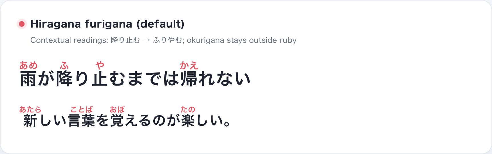
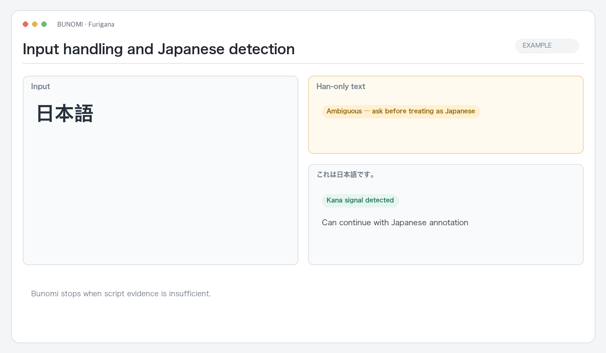
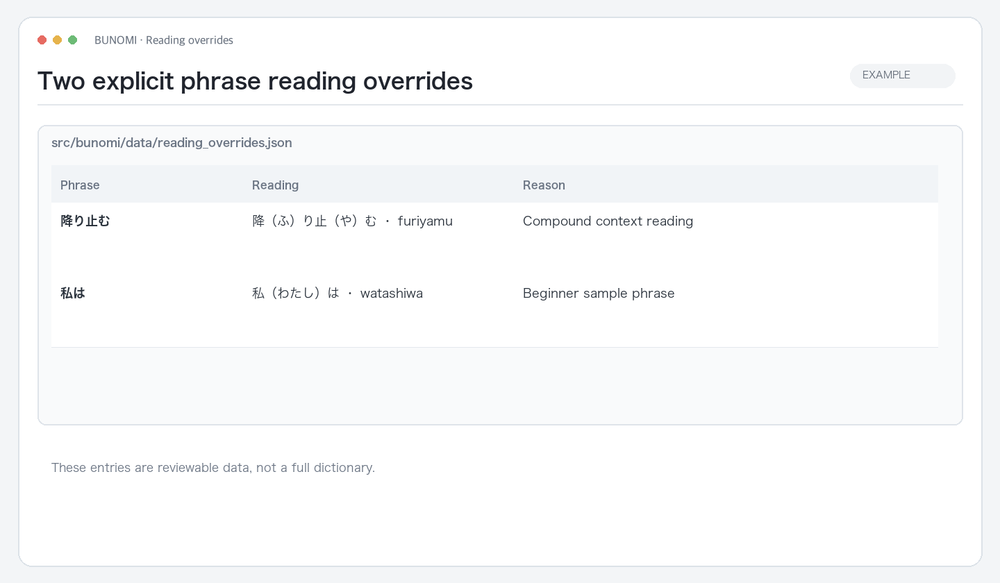
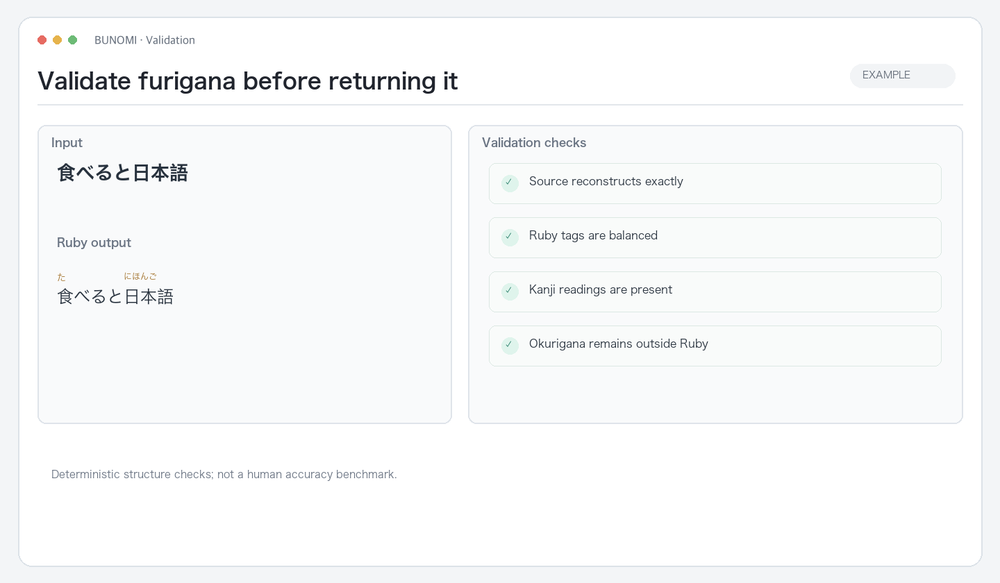
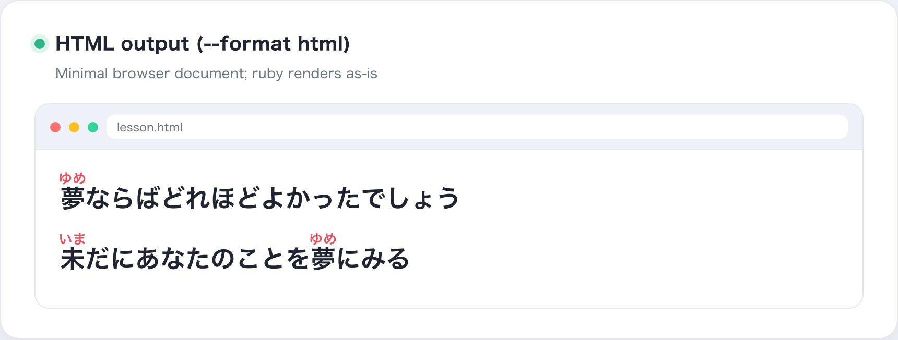
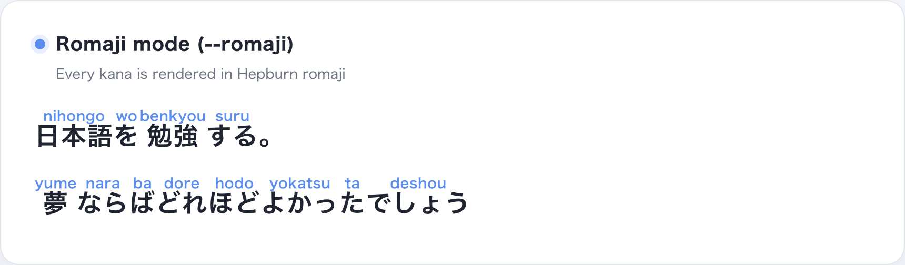

# Bunomi

**[English](README.md) · [简体中文](README.zh-CN.md) · [日本語](README.ja.md)**

A Japanese furigana Skill for ordinary text: articles, notes, messages, and learning material. Bunomi adds contextual readings, validates the annotated source, and returns a self-contained HTML page by default.

 Reading example · the kanji in 降り止む receive readings; り and む remain outside Ruby.

## How it works

~~~text
User-provided text → conservative script check → contextual readings → Ruby/source validation → HTML
~~~

The Skill workflow uses the repository's root <code>SKILL.md</code>. Install the Skill and ask an Agent to annotate the text. The local <code>bunomi</code> CLI is the deterministic engine for direct input, scripts, and file processing.

## Detection rules and limits

Bunomi uses Japanese script signals; it is not a full language-identification model.

- Text without hiragana or katakana is ambiguous and rejected by default.
- If text contains at least four Han characters, fewer than one kana per four Han characters is also treated as ambiguous.
- It cannot tell whether a Han-only span is Chinese or Japanese, or automatically split Japanese and Chinese spans in mixed text.
- If an ambiguous Han-only passage is Japanese, the user must confirm that first. The CLI escape hatch is <code>--assume-japanese</code>; it keeps a warning in the result.

When language is unclear, provide the Japanese portion explicitly instead of asking Bunomi to infer it.

 Detection example · 日本語 is ambiguous without kana; これは日本語です。 provides a Japanese script signal.

## Readings, preservation, and validation

Bunomi uses the reading API from [japanese-language-core](https://github.com/qweihu/japanese-language-core). The application does not expose engine or dictionary selection.

- Hiragana furigana is the default; Hepburn romaji is used only when requested.
- Original text, line breaks, punctuation, non-Japanese fragments, and meaningful blank lines are preserved.
- Okurigana remains outside the Ruby span; for example, the reading of 降り止む is attached to the kanji while り and む stay in the source text.
- Before output, checks verify Ruby structure, exact source reconstruction, and reading coverage for kanji. A failed check is reported; the result is not silently truncated.
- Phrase overrides are deliberately small and reviewable: 降り止む → ふりやむ and 私は → わたしは. This list is not a dictionary or a complete set of exceptions.

 Override data · inspect the phrase, reading, and reason for each maintained exception.

 Validation example · exact source reconstruction, balanced Ruby, reading coverage, and okurigana placement.

## Output modes

The Agent Skill returns self-contained HTML by default. It uses local styles and system fonts, with no CDN. Ask for Markdown or romaji when needed.

The CLI has two defaults:

| Input | Default result |
| --- | --- |
| Text argument or stdin | Ruby content printed to the terminal |
| UTF-8 text file | A new, timestamped HTML file beside the source |

The CLI never overwrites the input file. Use <code>--format markdown</code> or <code>--format html</code> to choose the file format.

 HTML output · open the generated page to see the readings over their kanji.

~~~bash
# Print Ruby markup
echo "日本語を読む" | .venv/bin/bunomi

# Request Hepburn readings
.venv/bin/bunomi "日本語を読む" --romaji

# Create a timestamped HTML sibling file
.venv/bin/bunomi --file lesson.txt

# Explicitly request Markdown
.venv/bin/bunomi --file lesson.txt --format markdown
~~~

 Romaji option · the alternate output appears only after an explicit request.

## Install the Skill

Python 3.10+:

~~~bash
python3 -m venv .venv
.venv/bin/python -m pip install -e .
.venv/bin/python scripts/install_bunomi_skill.py
~~~

This installs the repository as an Agent Skill in the default Codex skill directory. Add <code>--force</code> when replacing an existing installation. Agents can invoke <code>$bunomi</code>; use <code>PROMPT.md</code> in environments without Skill support.

The package installs the shared Core reading extra. The optional PyKakasi comparison engine is separate and its dependency chain includes GPL-3.0; it is not part of Bunomi's default installation.

## What Bunomi does not do

Bunomi annotates ordinary Japanese text. It does not search for or clean lyrics, translate, fetch URLs, or create lyric layouts. Those are separate workflows. It also does not claim that every reading is correct; structural checks and a small override list make behavior inspectable, while ambiguous or unvalidated cases remain visible.

## Develop

~~~bash
python3 -m venv .venv
.venv/bin/python -m pip install -e .
PYTHONPATH=src .venv/bin/python -m unittest discover -s tests -v
.venv/bin/python scripts/production_audit.py
~~~

The production audit covers Skill structure, golden reading cases, CLI formats, detection behavior, and safe file output.

## Project structure

~~~text
SKILL.md                         Agent workflow
PROMPT.md                        Standalone prompt fallback
src/bunomi/                      Detection, Core adapter, Ruby rendering, validation, CLI
src/bunomi/data/reading_overrides.json
scripts/install_bunomi_skill.py
tests/                            Unit and production-audit checks
~~~

MIT License. See [LICENSE](LICENSE).
