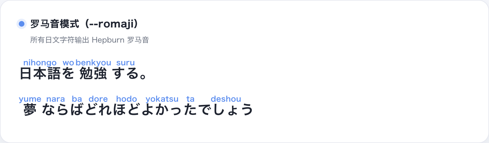
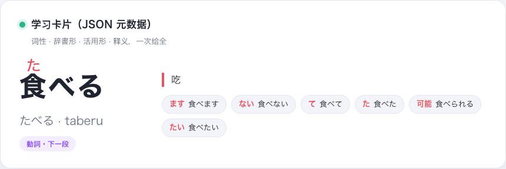
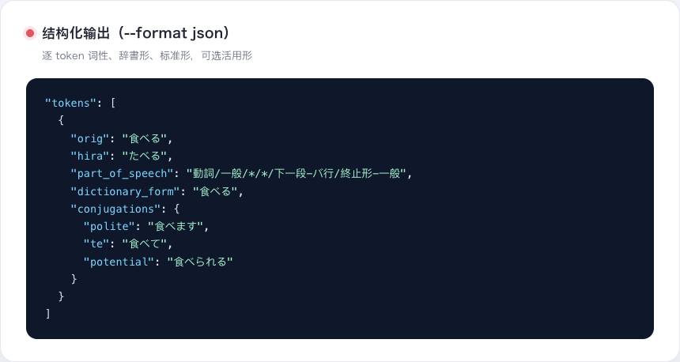
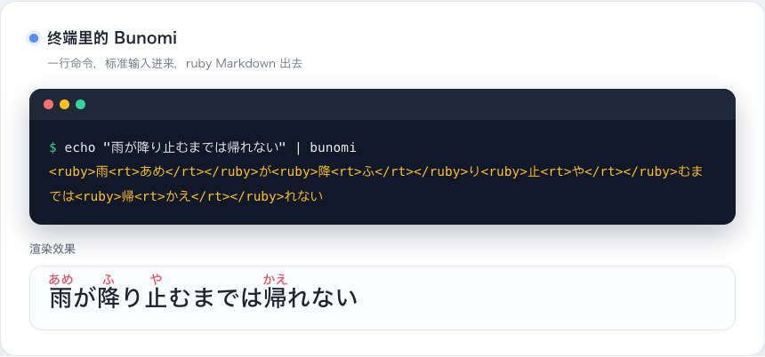
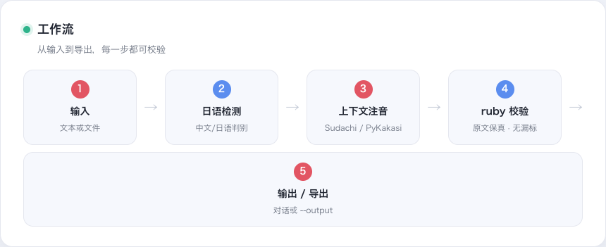
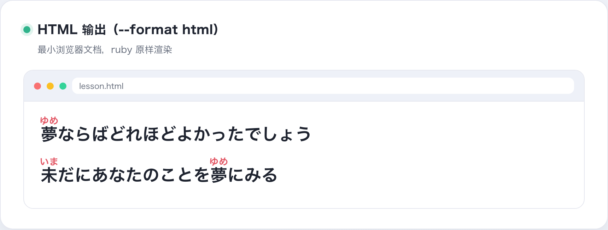
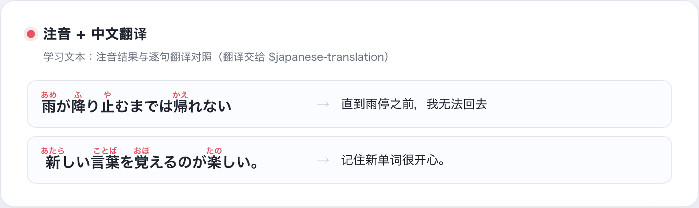
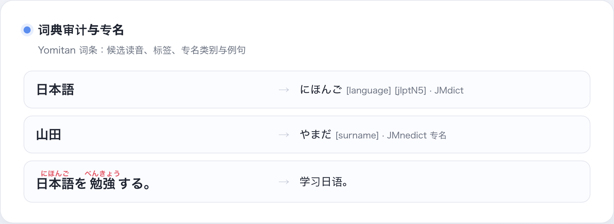

# Bunomi

**[English](README.md) | [简体中文](README.zh-CN.md) | [日本語](README.ja.md)**

给 Agent 使用的**日语注音技能**：判断输入是否像日语，为日语汉字生成可校验的
`<ruby>` 平假名/罗马音振假名，并在导出前校验结果。仓库本身就是技能
（根目录 `SKILL.md`），CLI 是技能背后的确定性引擎。

## 这是什么

- **技能层**：根目录 `SKILL.md` / `PROMPT.md` 供 Codex、Claude 等各类 Agent
  使用；`package.json` 是技能元数据。
- **引擎层**：本地 CLI（`bunomi`）+ Python 包，负责确定性读音（Sudachi 优先、
  PyKakasi 回退）、ruby 渲染与安全导出。
- **边界**：歌词抓取、翻译与排版交给专门的歌词技能和共享翻译技能
  `$japanese-translation`；Bunomi 只做注音这一件事。

## 效果预览

GitHub 的 README 不渲染 `<ruby>` 标签，以下是真实注音效果的渲染图。

<p align="center">
  
  <br><sub>平假名注音：上下文读音（降り止む → ふりやむ）与送假名处理</sub>
</p>

<p align="center">
  
  <br><sub>罗马音模式（--romaji）：所有日文字符输出 Hepburn 罗马音</sub>
</p>

<p align="center">
  
  <br><sub>学习卡片：词性、辞書形、活用形与释义一次给全</sub>
</p>

<p align="center">
  
  <br><sub>JSON 输出：逐 token 词性、辞書形、标准形与活用形</sub>
</p>

<p align="center">
  
  <br><sub>终端里的 Bunomi：一行命令，ruby Markdown 直接输出，下方是渲染效果</sub>
</p>

<p align="center">
  
  <br><sub>工作流：输入 → 检测 → 注音 → 校验 → 输出/导出，每一步都可校验</sub>
</p>

**日本語版 / English 版**：同一套九张图在 `screenshot/ja/` 与 `screenshot/en/`，
生成模板见 `scripts/screenshot/showcase.html`。

## 给 Agent 用

安装到 Codex 默认技能目录（已有安装需显式加 `--force`）：

```bash
.venv/bin/python scripts/install_bunomi_skill.py
```

Agent 引用 `$bunomi` 即可按 `SKILL.md` 工作流执行；不使用技能框架的环境
可以直接把 `PROMPT.md` 作为提示词。

## 给开发者用（CLI）

```bash
echo "夢ならばどれほどよかったでしょう" | .venv/bin/bunomi
.venv/bin/bunomi --file lesson.txt --format html
.venv/bin/bunomi "日本語を読む" --output ./exports/lesson.md --create-parent
.venv/bin/bunomi "雨が降り止むまでは帰れない" --engine sudachi
```

默认只输出到终端。导出必须使用明确的 `--output`，已有文件必须显式加
`--overwrite`。默认 `--engine auto` 优先使用 Sudachi 上下文引擎；
`--engine pykakasi` 可用于兼容回退；经过审核的短语规则默认启用，可用
`--no-overrides` 做诊断对比。

JSON 输出附带逐 token 元数据（词性、辞書形、标准形），可加
`--conjugations` 附带活用形，或 `--sentences/--sentence-links` 附带 Tatoeba
例句。

<p align="center">
  
  <br><sub>HTML 输出（--format html）：最小浏览器文档，ruby 原样渲染</sub>
</p>

## 翻译

用户要求翻译时，Bunomi 把翻译交给共享技能 `$japanese-translation`
（来自 [japanese-language-core](https://github.com/qweihu/japanese-language-core)
仓库），安装方式：

<p align="center">
  
  <br><sub>注音 + 中文翻译对照：学习文本的完整呈现</sub>
</p>

```bash
git clone https://github.com/qweihu/japanese-language-core.git
python3 scripts/install_skill.py --force
```

## 开发安装

```bash
python3 -m venv .venv
.venv/bin/python -m pip install -e .
```

安装过程会从公开的 [japanese-language-core](https://github.com/qweihu/japanese-language-core)
仓库获取固定的 `v0.3.0` 共享核心（读取能力需要 `[reading]` 扩展）。两个仓库
本地联调时，也可以使用：

```bash
.venv/bin/python -m pip install -e "/Users/qwei/Coding/japanese-language-core[reading]"
.venv/bin/python -m pip install -e . --no-deps
```

## 测试

```bash
PYTHONPATH=src python3 -m unittest discover -s tests -v
.venv/bin/python scripts/production_audit.py
```

生产审计会额外运行 Skill 结构校验、真实注音标准答案、CLI 格式、日语检测和
导出安全测试；标准答案位于 `tests/fixtures/golden_cases.json`。当前审计结论见
[docs/production-audit.md](docs/production-audit.md)。

## 项目结构

```text
SKILL.md                     # 技能入口（仓库即技能）
PROMPT.md                    # 无技能框架时的独立提示词
package.json                 # 技能元数据
agents/openai.yaml           # Codex UI 元数据
docs/requirements.md         # MVP 需求与验收标准
docs/yomitan-data-plan.md    # Yomitan 词典来源、版本和审计接入方案
src/bunomi/core.py           # 检测、引擎适配、ruby 渲染、校验
src/bunomi/engine.py         # 共享核心读取能力的入口（japanese_language_core.reading）
src/bunomi/cli.py            # CLI 与安全导出
scripts/install_bunomi_skill.py # 可重复安装 Bunomi Skill
scripts/fetch_yomitan_data.py # 获取并登记 Yomitan 词典快照
scripts/audit_yomitan_data.py  # 校验快照完整性和基本索引样本
scripts/audit_reading_disagreements.py # 输出主引擎与词典候选的差异
tests/test_core.py           # 无外部服务的核心测试
```

## Yomitan 词典快照

Bunomi 将 Yomitan/JMdict 数据作为词典增强和审计来源，Sudachi 仍负责默认的
上下文读音。需要获取数据时运行：

<p align="center">
  
  <br><sub>词典审计：候选读音、标签、JMnedict 专名与例句</sub>
</p>

```bash
.venv/bin/python scripts/fetch_yomitan_data.py --extract
.venv/bin/python scripts/audit_yomitan_data.py
.venv/bin/python scripts/audit_reading_disagreements.py
```

共享引擎的源码、测试和 distribution 元数据位于独立仓库：

```bash
python3 -m pip wheel --no-deps /Users/qwei/Coding/japanese-language-core -w dist/shared-engine
```

数据保存在被忽略的 `var/yomitan/`，版本、来源和 SHA-256 位于 `manifest.json`。
完整方案见 [docs/yomitan-data-plan.md](docs/yomitan-data-plan.md)。

共享边界说明见 [japanese-language-core](https://github.com/qweihu/japanese-language-core)
仓库的文档。
