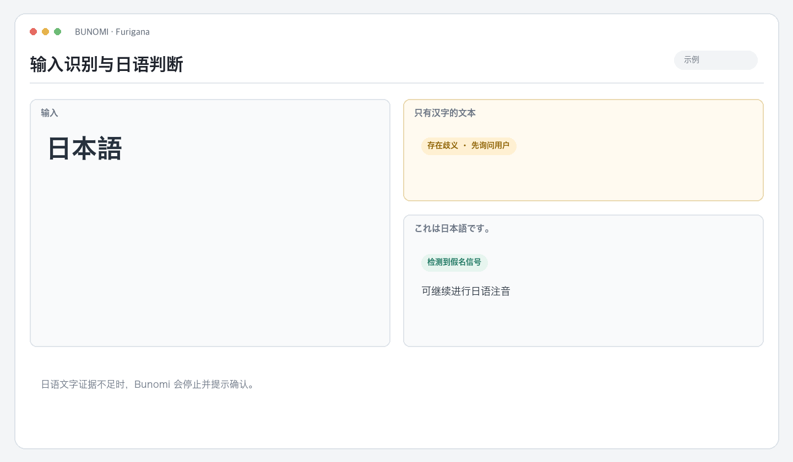
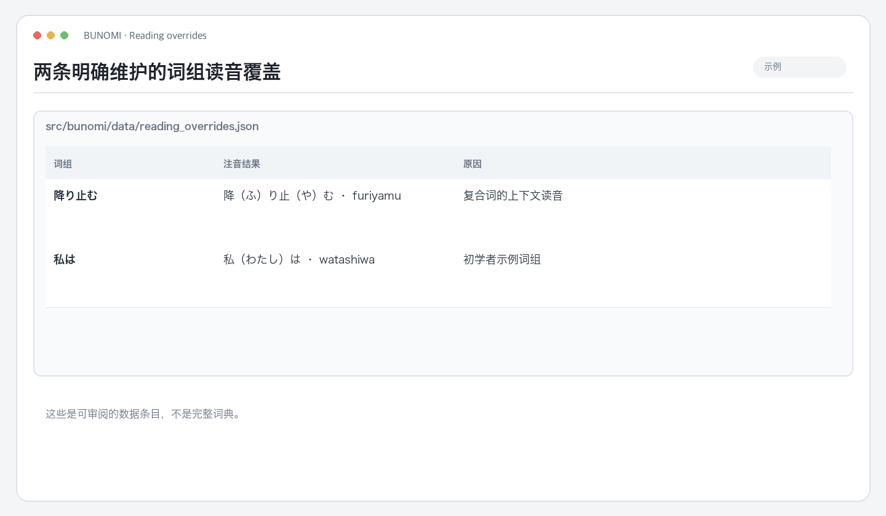
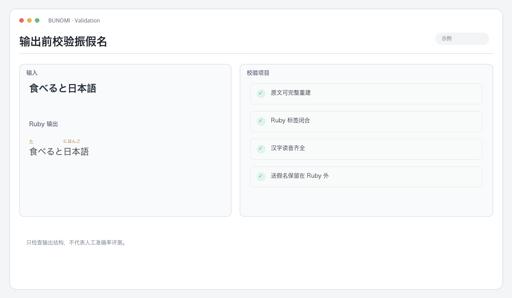

# Bunomi

**[English](README.md) · [简体中文](README.zh-CN.md) · [日本語](README.ja.md)**

面向普通日语文本的振假名 Skill，适合文章、笔记、消息和学习材料。Bunomi 添加上下文读音，校验注音结果，默认返回可独立打开的 HTML 页面。

 注音示例 · 为「降り止む」中的汉字标注读音，り 和 む 保留在 Ruby 外。

## 处理流程

~~~text
用户提供文本 → 保守判断文字脚本 → 上下文注音 → 校验 Ruby 和原文 → HTML
~~~

Agent 工作流由仓库根目录的 <code>SKILL.md</code> 定义。安装 Skill 后可直接让 Agent 注音；本地 <code>bunomi</code> 命令是确定性引擎，也可用于脚本和文件处理。

## 判断规则与边界

Bunomi 根据日语文字脚本信号判断输入，不是完整的语种识别模型。

- 没有平假名或片假名的文本会被视为歧义，默认拒绝处理。
- 汉字达到 4 个时，如果假名少于每 4 个汉字对应 1 个，也会被视为歧义。
- 它不能判断纯汉字片段究竟是中文还是日文，也不会自动从中日混合文本中切出日语部分。
- 如果纯汉字文本确实是日语，用户需要先明确确认。CLI 可使用 <code>--assume-japanese</code> 绕过歧义检查，但结果会保留警告。

语言不明确时，请直接提供其中的日语部分，不要要求 Bunomi 猜测。

 识别示例 · 「日本語」有歧义；「これは日本語です。」带有日语文字信号。

## 读音、原文保留与校验

Bunomi 使用 [japanese-language-core](https://github.com/qweihu/japanese-language-core) 的读音 API。普通使用流程不要求用户选择引擎或词典。

- 默认添加平假名振假名；只有用户提出要求时才使用 Hepburn 罗马音。
- 保留原文、换行、标点、非日语片段和有意义的空行。
- 送假名留在 Ruby 标签之外。例如「降り止む」只给汉字部分添加读音，り、む仍在原文中。
- 输出前检查 Ruby 结构、原文是否逐字还原、汉字是否都有读音。检查失败会报告错误，不会静默截断。
- 词组覆盖规则刻意保持少而透明：降り止む → ふりやむ、私は → わたしは。它不是词典，也不是完整例外表。

 覆盖数据 · 可以逐项查看维护词组、读音和设置原因。

 校验示例 · 检查原文还原、Ruby 完整性、读音覆盖与送假名位置。

## 输出方式

Agent Skill 默认返回独立 HTML，样式与页面一起保存，使用系统字体，不依赖 CDN。需要 Markdown 或罗马音时可直接提出。

CLI 根据输入方式采用不同默认值：

| 输入 | 默认结果 |
| --- | --- |
| 文本参数或标准输入 | 在终端输出 Ruby 内容 |
| UTF-8 文本文件 | 在原文件旁新建带时间戳的 HTML 文件 |

CLI 不会覆盖原文件。处理文件时可通过 <code>--format markdown</code> 或 <code>--format html</code> 指定格式。

 HTML 输出 · 打开生成的页面即可查看汉字上方的读音。

~~~bash
# 输出 Ruby 标记
echo "日本語を読む" | .venv/bin/bunomi

# 请求 Hepburn 罗马音
.venv/bin/bunomi "日本語を読む" --romaji

# 在同目录新建带时间戳的 HTML
.venv/bin/bunomi --file lesson.txt

# 明确要求 Markdown
.venv/bin/bunomi --file lesson.txt --format markdown
~~~

 罗马音选项 · 只有用户明确要求时才切换。

## 安装 Skill

需要 Python 3.10+：

~~~bash
python3 -m venv .venv
.venv/bin/python -m pip install -e .
.venv/bin/python scripts/install_bunomi_skill.py
~~~

此脚本会把当前仓库安装到 Codex 默认 Skill 目录。替换已有安装时添加 <code>--force</code>。Agent 可调用 <code>$bunomi</code>；没有 Skill 机制时，可直接使用 <code>PROMPT.md</code>。

安装包会带上共享 Core 的读音扩展。可选的 PyKakasi 对照引擎需要单独安装，其依赖链含 GPL-3.0，不属于 Bunomi 默认依赖。

## Bunomi 不负责什么

Bunomi 只给普通日语文本注音，不搜索或清理歌词、不翻译、不抓取 URL，也不生成歌词专用排版。它不会声称每个读音都正确：结构校验和少量覆盖规则让行为可检查；无法判断或校验失败的情况仍会明确报告。

## 开发

~~~bash
python3 -m venv .venv
.venv/bin/python -m pip install -e .
PYTHONPATH=src .venv/bin/python -m unittest discover -s tests -v
.venv/bin/python scripts/production_audit.py
~~~

生产审计覆盖 Skill 结构、黄金读音用例、CLI 格式、日语判断和安全文件输出。

## 项目结构

~~~text
SKILL.md                         Agent 工作流
PROMPT.md                        独立提示词备用方案
src/bunomi/                      日语判断、Core 适配器、Ruby 渲染、校验和 CLI
src/bunomi/data/reading_overrides.json
scripts/install_bunomi_skill.py
tests/                            单元测试与生产审计
~~~

MIT 许可证，见 [LICENSE](LICENSE)。
